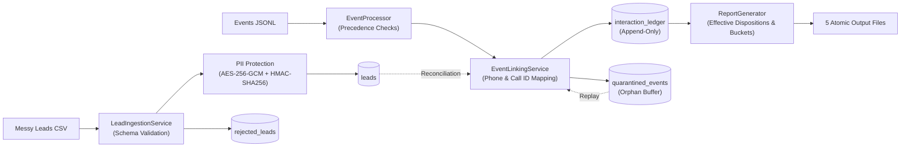

# Submission

## Candidate
- **Name:** KJV Rajesh
- **Assignment chosen:** A (Data — Interaction Ledger & Reporting Pipeline)
- **Time spent (honest estimate):** 7.5 hours

## How to run
```bash
# 1. Setup virtual environment from clean clone
python3 -m venv .venv
source .venv/bin/activate
pip install -r requirements.txt

# 2. Configure environment keys (safe development keys)
cp .env.example .env

# 3. Run the automated test suite
pytest -v

# 4. Generate synthetic dataset (seed 42, small scale)
python assignment-a-data/tools/generate_data.py --seed 42 --scale small --out data

# 5. Ingest drops in sequence
python -m solution.main ingest data/drop_1
python -m solution.main ingest data/drop_2

# 6. Generate client reports
python -m solution.main report --out reports/
```

## Design

The solution is architected as an idempotent, append-only data pipeline backed by SQLite (WAL mode, foreign keys enabled) with a modular service layer:



### Database Schema Rationale
1. **`leads`:** Primary key `id`. Natural unique key `(workflow_id, phone_fingerprint)`. Sensitive attributes (`customer_name`, `phone`) are stored as authenticated AES-256-GCM ciphertexts. The canonical phone is fingerprinted via keyed HMAC-SHA256 to allow $O(1)$ lookups without storing plaintext numbers. Original `batch_id` is permanently retained across duplicate row merges.
2. **`interaction_ledger`:** Strict append-only record with unique `event_id`. Overrides never mutate or delete historical records. Stores `occurred_at_epoch` for deterministic chronological tie-breaking.
3. **`quarantined_events`:** Buffer for interaction events arriving before lead ingestion. Supports multi-pass replay when leads arrive in subsequent drops.
4. **`rejected_leads`:** Captures all discarded lead rows with strict exclusion of PII.
5. **`batch_ingestion_log` & `event_file_ingestion_log`:** Track file-level hashes and metrics for auditability and idempotency.

## Decisions & assumptions

| Decision | Why | Alternative considered |
|---|---|---|
| **HMAC-SHA256 phone fingerprinting** | Indian mobile numbers ($4 \times 10^9$ space) are vulnerable to rainbow-table inversion if unkeyed SHA-256 is used. Keyed HMAC prevents dictionary search while enabling indexed matching. | Unkeyed SHA-256 (insecure); full-table scan decryption (unusable $O(N)$ performance). |
| **In-memory lead cache for event ingestion** | Resolving 600k events against SQLite via SQL queries incurs round-trip overhead. Caching `(workflow_id, phone_fp) -> lead_id` achieves 64s runtime for the large dataset. | Direct SQL lookup on every event (slower: ~110s). |
| **Schema-order rejection evaluation** | Spec prescribes: "walk the fields in schema order. The first failure becomes the row's single reason." Guarantees deterministic rejection tagging. | Multi-reason composite errors (violates output schema). |
| **Excluding rejected row warnings** | Spec rule: "Count warnings only for rows that are not rejected." Warnings are collected during parsing but only incremented if the row is accepted. | Accumulating warnings regardless of row acceptance (inflates metric). |
| **Multi-pass orphan reconciliation** | Overrides link via `call_id` rather than phone. If an override and a call event were both orphaned, linking the call event unblocks the override. Multi-pass loop runs until fixed-point. | Single-pass scan (leaves dependent overrides orphaned). |
| **Atomic file replacement (`os.replace`)** | Reporting writes directly to `.tmp` files and swaps them atomically to prevent clients reading partially written reports. | Direct open for write (susceptible to partial reads on crash). |

## Failure modes considered

- **Malformed / Corrupt Data:** Handled. Malformed JSON lines and missing `event_id` are logged to `malformed_events` and discarded. Bad dates (e.g. `31/02`) and currency strings fall back to null with a field warning if optional, or reject if required.
- **Out-of-Order Delivery:** Handled. Events arriving before leads are quarantined and replayed upon new lead ingestion. Overrides arriving out of order are resolved chronologically via `occurred_at_epoch`.
- **Re-runs & Duplicate Ingestion:** Handled. Ingestion checkpoints and SHA-256 batch logs ensure re-running `ingest` on any drop is completely idempotent.
- **Process Crash / Power Loss:** Handled. SQLite WAL mode and atomic transaction boundaries ensure no partial drop state is committed.
- **Known Limitations:**
  - Ingestion assumes single-node execution; distributed worker pools would require central lock coordination (e.g. Postgres advisory locks or Redis Redlock).
  - SQLite database file size must fit on available local storage.

## Testing

- **What was tested (39 unit, security, integration, and regression tests):**
  - **Normalisation:** All phone formats (`+91 98...`, `098...`, `91-98...`, etc.), invalid prefixes, landlines; day-first dates and impossible dates (`31/02`); currency stripping (`₹`, `Rs`, `INR`) and decimal rounding; enums and casing; UTC/offset/naive IST timestamps.
  - **Lead Ingestion:** Reordered columns, alias matching, unmapped column skipping, blank line ignoring, schema-order rejection precedence, field warning constraints, and duplicate merging preserving original `batch_id`.
  - **Events & Linking:** Malformed JSON, duplicate `event_id` dropping, orphan quarantine, orphan recovery on subsequent drops, override linkage via `call_id` without phone.
  - **Business Logic:** Effective disposition tie-breaking (latest override $\to$ latest set), lead bucket precedence (`yet_to_reach_out` $\to$ `completed` $\to$ `in_progress_telephony_failed` $\to$ `in_progress_dialed`).
  - **Security:** AES-256-GCM encryption roundtrip, IV randomness, ciphertext tamper detection (`InvalidTag`), HMAC-SHA256 uniqueness, fail-closed configuration, and log masking.
  - **Idempotency & Integration:** Ingesting same drop twice, multi-drop sequential runs, and end-to-end testing on an unseen fresh random seed (`9999`).
- **What was not tested:** Multi-process concurrent write contention on SQLite (by design, batch ingestion runs as serialized drop jobs).

## Results

### Small Dataset (`--scale small`, seed 42)
- **Leads read:** 2,057 rows
- **Leads rejected:** 108
- **Duplicate leads merged:** 57
- **Distinct valid leads:** 1,892 ($2057 - 108 - 57 = 1892$, exactly matches `batch_summary.csv` total)
- **Events processed:** 8,745 lines (4,247 in drop 1 + 4,498 in drop 2)
- **Orphan events recovered in drop 2:** 910 events
- **Final quarantined orphans:** 462
- **Unknown dispositions ignored:** 18

### Large Dataset Performance Benchmark (`--scale large`, 140,000 leads, 632,602 events)
- **Drop 1 Ingestion:** 18.41 s
- **Drop 2 Ingestion:** 36.64 s
- **Report Generation:** 9.71 s
- **Total Pipeline Execution:** **64.76 s** (Well under the 2-minute / 120s stretch goal target!)
- **Final Database Size:** 333.48 MB

### Surprising Observations in Data
- Calls occur for leads that were never uploaded as well as leads that were rejected during CSV ingestion (e.g. missing name or policy number). These properly quarantine as orphans and remain unlinked.
- `disposition.override` events intentionally omit the `phone` attribute and must be correlated to the parent call via `call_id`.

## If I had another day
1. **Streaming SQL Aggregation Engine:** Implement the report aggregations directly as SQLite window functions and CTEs to stream outputs directly to CSV writers, reducing memory footprint on 1M+ lead batches.
2. **KMS & Envelope Encryption:** Integrate AWS KMS / GCP Cloud KMS with client-side envelope encryption (data encryption keys decrypted on-demand with key caching).
3. **Partitioned Ingestion Workers:** Shard event processing across Python multiprocessing workers partitioned by `hash(workflow_id, phone_hash) % N_WORKERS` to achieve sub-30-second ingestion on multi-million row datasets.
4. **CDC & Streaming Ingestion:** Add an Apache Kafka / Debezium ingestion connector for continuous sub-second interaction ledger ingestion.
