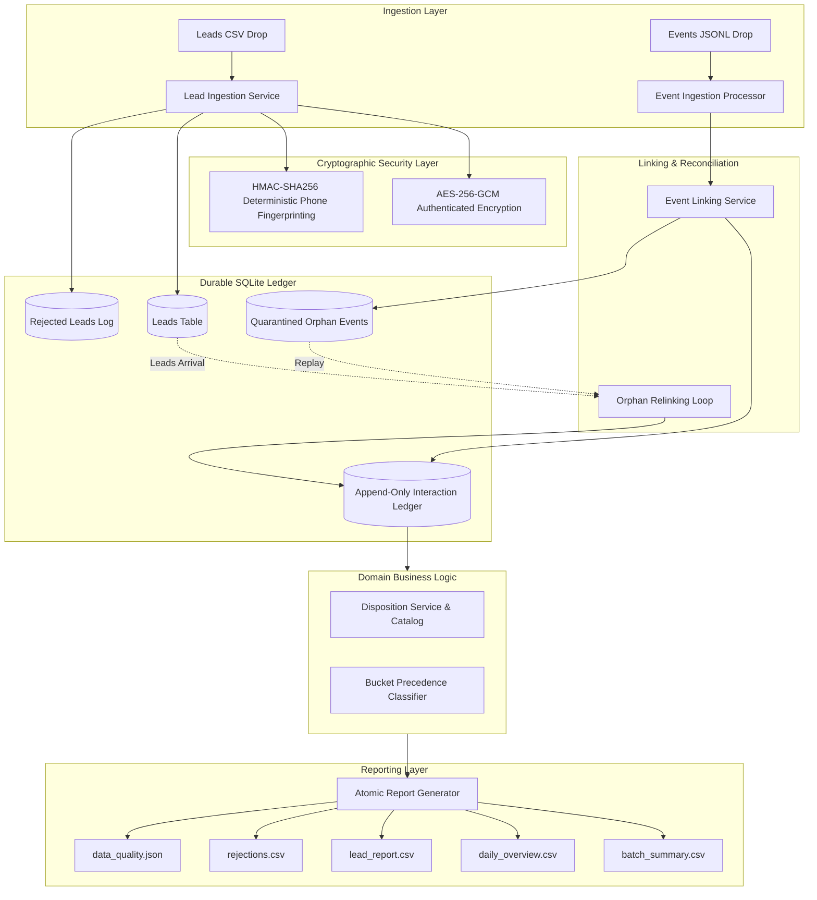

# System Architecture

## Overview

The **Agentic Universe Interaction Ledger & Reporting Pipeline** processes high-volume outbound voice campaigns for insurers and consumer brands. It provides durable schema-driven messy-data ingestion, append-only interaction ledger recording, authenticated cryptographic PII protection, automatic orphan event reconciliation, and deterministic analytical report generation.

## Component Breakdown

### 1. Ingestion Pipeline
- **Schema-Driven Lead Ingestion (`solution/lead_ingestion.py`):** Dynamically parses workflow specifications from JSON definitions, maps reordered and aliased columns, discards blank lines, validates data types in strict schema order, and routes rejected rows to quarantine.
- **Append-Only Event Processor (`solution/event_processor.py`):** Ingests streaming JSONL events following strict validation precedence: Malformed $\to$ Duplicate $\to$ Orphan $\to$ Unknown Disposition $\to$ Ledger.

### 2. Cryptographic PII Protection (`solution/pii_protection.py`)
- Employs AES-256-GCM authenticated encryption for reversible PII attributes (`customer_name`, `phone`).
- Implements keyed HMAC-SHA256 deterministic phone fingerprinting to resolve `(workflow_id, phone_fingerprint)` identity without storing or querying plaintext numbers.
- Constant-time verification using `hmac.compare_digest`.
- Sanitizes log output via `PIIRedactionFilter`.

### 3. Event-to-Lead Linking & Orphan Recovery (`solution/event_linking.py`)
- Matches interaction events to leads using phone fingerprints.
- Links `disposition.override` events (which omit phone numbers) via historical `call_id` linkage in the ledger.
- Maintains `quarantined_events` for out-of-order events where calls occurred before lead ingestion. Executes multi-pass reconciliation when new lead drops arrive.

### 4. Domain & Business Logic
- **Disposition Service (`solution/disposition_service.py`):** Resolves call effective dispositions: latest override by occurred epoch $\to$ latest disposition.set $\to$ none.
- **Bucket Service (`solution/bucket_service.py`):** Evaluates lead lifecycle states strictly following precedence: `yet_to_reach_out` $\to$ `completed` $\to$ `in_progress_telephony_failed` $\to$ `in_progress_dialed`.

### 5. Reporting Engine (`solution/reporting.py`)
- Computes aggregated campaign metrics, connectivity rates formatted to four decimal places, and daily distinct success lead counts.
- Employs atomic tempfile replacement (`os.replace`) to guarantee zero file corruption or partial reads.
