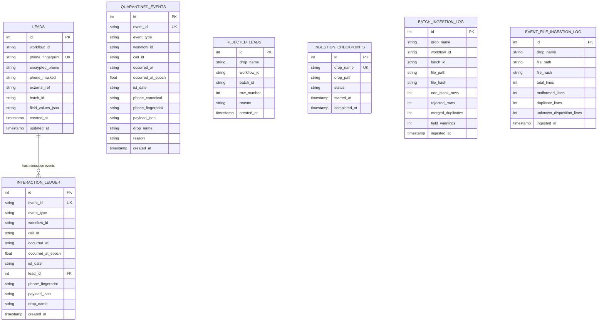

# Relational Data Model & Schema Design

## Database Schema Overview

The database is built on SQLite with WAL (`Write-Ahead Logging`) mode enabled, foreign key enforcement, and explicit transactional boundaries.

## Entity Descriptions

### 1. `leads`
- **Primary Key:** `id` (INTEGER AUTOINCREMENT)
- **Natural Business Key:** `(workflow_id, phone_fingerprint)`
- **Attributes:**
  - `phone_fingerprint`: 64-character HMAC-SHA256 hex string of canonical phone (`+91XXXXXXXXXX`).
  - `encrypted_phone`: Base64 AES-256-GCM ciphertext with authenticated 12-byte nonce.
  - `phone_masked`: Safe masked representation (`+91******XXXX`).
  - `external_ref`: Business reference key (e.g. `policy_number`, `order_id`).
  - `batch_id`: Permanent file stem of the first valid row that introduced this lead.
  - `field_values_json`: JSON-serialized dictionary of normalized attributes (with sensitive fields encrypted).
- **Constraints & Indexes:**
  - `UNIQUE (workflow_id, phone_fingerprint)`
  - Index on `(workflow_id, external_ref)`
  - Index on `(workflow_id, batch_id)`

### 2. `interaction_ledger`
- **Primary Key:** `id`
- **Natural Key:** `event_id` (UNIQUE)
- **Attributes:**
  - `event_type`: e.g. `call.initiated`, `call.connected`, `call.telephony_failed`, `call.ended`, `disposition.set`, `disposition.override`.
  - `workflow_id`: Workflow identifier.
  - `call_id`: Call instance identifier.
  - `occurred_at`: ISO-8601 formatted timestamp in IST (`YYYY-MM-DDTHH:MM:SS+05:30`).
  - `occurred_at_epoch`: Floating-point epoch seconds for deterministic sorting.
  - `ist_date`: IST date string (`YYYY-MM-DD`) for daily overview partitioning.
  - `lead_id`: Foreign key referencing `leads(id)`.
  - `payload_json`: Raw JSON event payload.
- **Constraints & Indexes:**
  - `event_id UNIQUE`
  - Index on `call_id`
  - Index on `lead_id`
  - Index on `(workflow_id, ist_date)`
  - Index on `(call_id, occurred_at_epoch)`

### 3. `quarantined_events`
- Stores valid interaction events that arrived prior to the corresponding lead being uploaded.
- Retains full metadata and event payload for deterministic replay when later drops arrive.

### 4. `rejected_leads`
- Stores discarded CSV rows that failed schema validation.
- Contains `drop_name`, `workflow_id`, `batch_id`, `row_number`, and `reason` (e.g., `missing_required:customer_name`, `invalid_phone`).
- **Strictly contains zero PII.**

### 5. Ingestion Logs & Checkpoints
- `ingestion_checkpoints`: Tracks drop-level completion to ensure idempotency.
- `batch_ingestion_log`: Records per-file CSV metrics and SHA-256 content hashes.
- `event_file_ingestion_log`: Records per-file JSONL metrics and SHA-256 content hashes.
