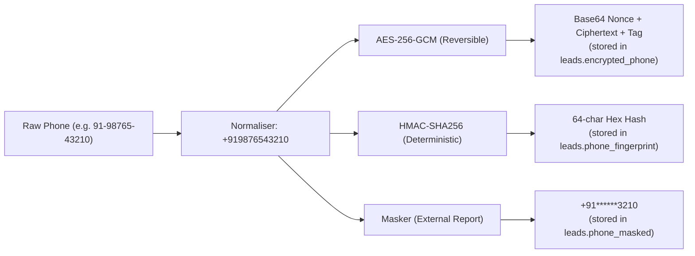

# PII Security & Cryptographic Architecture

## Security Objectives

1. **Zero Plaintext PII at Rest:** Fields flagged `"pii": true` in workflow schemas (e.g. `customer_name`, `phone`) must never exist in unencrypted form in persistent database tables or logs.
2. **Deterministic Searchability:** Events must match leads without decrypting all database records or storing plaintext lookup indexes.
3. **Fail-Closed Operation:** System startup and ingestion must halt if cryptographic keys are absent or corrupted.
4. **Resilience to Offline Attacks:** Prevent rainbow-table and dictionary attacks on 10-digit Indian mobile numbers.

---

## Cryptographic Design

### 1. Authenticated Encryption (AES-256-GCM)
- **Algorithm:** AES in Galois/Counter Mode with 256-bit key length (`AESGCM`).
- **Nonce/IV:** Fresh, cryptographically secure 96-bit (12-byte) pseudo-random IV (`os.urandom(12)`) generated for every single encryption operation.
- **Payload Structure:** 12-byte IV prepended to the ciphertext and 16-byte authentication tag:
  $$\text{Payload} = \text{Base64}(\text{IV} \mathbin{\Vert} \text{Ciphertext} \mathbin{\Vert} \text{Tag})$$
- **Integrity Guarantee:** Any bit tampering in the ciphertext or metadata causes GCM authentication failure (`InvalidTag`), immediately raising `PIIDecryptionError`.

### 2. Keyed Deterministic Phone Fingerprinting (HMAC-SHA256)
- **Problem with Raw Hashing:** The space of valid Indian mobile numbers is constrained ($4 \times 10^9$ possibilities starting with 6, 7, 8, or 9). An ordinary unkeyed SHA-256 hash can be precomputed and cracked using rainbow tables in minutes on standard commodity hardware.
- **Solution:** A keyed Hash-based Message Authentication Code (`HMAC-SHA256`) using a dedicated, high-entropy secret (`APP_HMAC_SECRET`).
  $$\text{Fingerprint} = \text{HMAC-SHA256}_{K_{\text{HMAC}}}(\text{Canonical Phone})$$
- **Verification:** Evaluated via constant-time comparison (`hmac.compare_digest`) to prevent timing side-channel attacks.

### 3. Log Redaction & Safe Development Setup
- **PIIRedactionFilter:** Custom logging filter intercepts all log records and applies regex-based masking to any phone number patterns before standard logging formatters execute.
- **Key Separation:** Local development uses keys defined in `.env` (derived from `.env.example`).
- **Production Key Management Recommendation:** In enterprise production, keys should be managed through cloud key management systems such as AWS KMS, GCP Cloud KMS, or HashiCorp Vault with hardware security modules (HSM) and automated key rotation policies.
